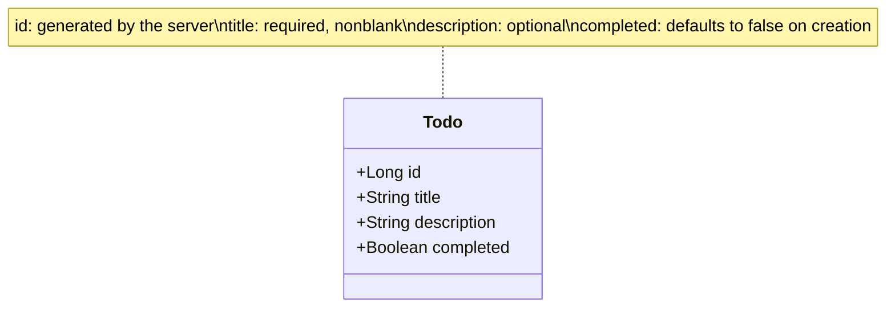

User: What endpoints should a simple ToDo API provide?

GPT-6.1 Sol:

For a simple ToDo API, start with five CRUD endpoints:

| Method | Endpoint | Purpose | Success |
|---|---|---|---|
| `GET` | `/todos` | List all ToDos; return `[]` when empty | `200 OK` |
| `GET` | `/todos/{id}` | Retrieve one ToDo | `200 OK` |
| `POST` | `/todos` | Create a ToDo with a server-generated ID | `201 Created` |
| `PUT` | `/todos/{id}` | Replace an existing ToDo’s editable fields | `200 OK` |
| `DELETE` | `/todos/{id}` | Delete a ToDo | `204 No Content` |

Use JSON request and response bodies. Return `400 Bad Request` for invalid input and `404 Not Found` for unknown IDs. Creation should return the new ToDo and a `Location` header pointing to `/todos/{id}`.

Optionally add `PATCH /todos/{id}` for partial updates, such as marking a ToDo completed. For this demo, the five endpoints above are enough; completion can use `PUT`.

User: Propose a Mermaid class diagram for a simple ToDo resource served by the simple ToDo API.

GPT-6.1 Sol:

I’d keep the ToDo resource to four fields:

Using `Boolean` lets request validation distinguish an omitted `completed` field from an explicit `false`. The resource needs no methods; CRUD behavior belongs in `TodoService`.